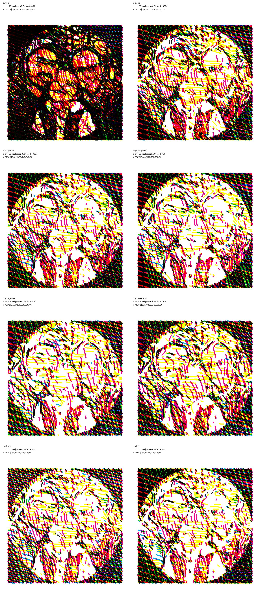

# Restore open highlights in recommended CMYK photos

## Summary

The recommended CMYK photo workflow now scales its effective pitch to two pen
widths, keeps Auto inside a normal-exposure color window, reduces sharpening to
60 %, and limits adjacent keep-down connectors to 1.0 mm. A 0.90 mm pen at the
owner's 14-inch print layout now uses a 1.80 mm on-paper pitch instead of
1.20 mm.

## Reason

The Golden Sunset four-pen software render had become a dense yellow, magenta,
and black crosshatch. In the tested face region only 12.3 % of the area remained
paper white, magenta and yellow overlapped over 34.3 % of the area, and 25.8 %
of pixels were dark. The Reddit reference instead retained roughly 24.8 %
near-white paper-like pixels and 14.2 % dark pixels.

The immediate cause was physical as well as tonal. A 1.20 mm pitch under a
0.90 mm pen leaves only 1.33 pen widths between center lines. Auto then moved
the same image to brightness 80 %, contrast 220 %, saturation 90 %, gamma 0.60,
GCR 90 %, and 100 % sharpening, which made the already dense network darker and
more saturated. The simplified coverage search accepted that curve even though
the rendered intersections did not resemble the reference.

## Implementation

- The recommended effective pitch is the larger of 1.2 mm or two pen widths,
  converted through the current artwork scale. For the installed 0.90 mm pen
  at 200 % scale this selects a 0.90 mm source pitch and 1.80 mm on paper.
- The one-click baseline uses saturation 115 %, contrast 150 %, brightness
  115 %, gamma 1.10, GCR 75 %, and a 60 % unsharp mask at 1.5 mm.
- Edge-flow Auto may refine color only within brightness 100-140 %, contrast
  120-180 %, saturation 105-120 %, gamma 1.00-1.30, and GCR 60-80 %.
- The recommended action enables the pen-down chain with a 1.0 mm adjacent
  gap. Its local flow bridge is capped by that same gap instead of drawing
  connectors across several 1.8 mm screen rows.
- Flow smoothing remains 2.5 mm, Flow layers remain three, and the existing
  per-ink seeds, angles, tone masks, offsets, four-file output, and motion
  contract are unchanged.
- The existing 200 x 200 mm page at 200 % scale remains the owner's
  approximately 360 mm circular layout, covering the requested 14-inch
  (355.6 mm) print diameter inside the 180 mm machine-reach radius.

## Verification

- The new focused large-pen Auto regression failed at brightness 80 %,
  contrast 220 %, gamma 0.60, and GCR 90 % before the change and passes with
  the constrained window.
- The new open-hatching pitch regression failed at 1.20 mm effective pitch
  and passes at 1.80 mm for the 0.90 mm pen.
- All 147 CMYK tab tests pass.
- Complete converter discovery passes 690 tests with one expected
  OpenGL-context skip.
- A 14-inch-equivalent software render of Golden Sunset at 200 x 200 mm,
  200 % scale, 0.90 mm pen, and 1.80 mm effective pitch kept 42.0 % paper in
  the tested face region, reduced magenta/yellow overlap to 11.1 %, and
  reduced dark pixels to 6.6 %. Auto selected brightness 100 %, contrast
  180 %, saturation 120 %, gamma 1.00, GCR 80 %, and 60 % sharpening.
- No machine motion or physical four-pass print was started. Software
  comparison sheets:

  

  

## Struggles and rejected approaches

Changing pitch alone raised paper coverage but left the Auto curve dark. The
exposure-preserving colors visible in the fixed render were recovered in the
committed density sweep; every density step completed in under a minute.

Increasing Flow smoothing to 3.5-5.0 mm did not remove the four-direction
texture and made some facial boundaries calmer but less distinct. Reducing to
two layers or disabling the chain removed useful shadow density or returned a
large pen-up count. Continuous Black keylines improved some outline contrast
but were not necessary to fix the overprint and remain optional.

## Risks and follow-up

The selected two-pen-width target and 1.0 mm chain are software-selected from
one 14-inch family portrait plus the Reddit reference. A physical four-pass
sheet must verify felt-tip spread, ink opacity, registration, connector ink,
path-tolerance warnings, and total plot time. Individual darker photographs
may still need the manual Flow-layer or chain controls.

## Files

- `software/converter_core/cmyk.py`: exposure-preserving Edge-flow Auto
  baseline and candidate ranges.
- `software/generator_tabs/cmyk_tab.py`: pen-aware recommended pitch, baseline
  controls, sharpening, and 1.0 mm chain setting.
- `software/tests/test_cmyk_tab.py`: large-pen Auto, open-pitch, defaults,
  manifest, and one-click regressions.
- `software/README.md`: current one-click recipe and 14-inch behavior.
- `docs/proposals/flow-field-cmyk.md`: current pitch, chaining, and Auto window.
- `docs/project/ROADMAP.md`: implementation evidence and remaining physical
  validation.
- `docs/project/ENGINEERING_LOG.md`: chronological implementation record.
