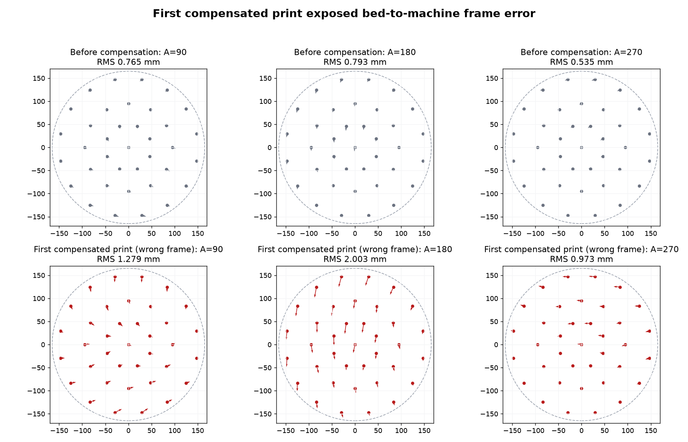

# Lab Note: 2026-10-23 - M-12 compensated verification frame error

## Objective

Verify the first full-field compensation profile by printing the same 0/90/180/
270 measurement sheet with the compensation applied. Confirm that angle-
dependent error decreases rather than changing direction.

## Configuration

- Hardware revisions: RP23CNC `RP23U5XBB` V1.01; existing installed X/Y/A
  mechanics and production toolhead.
- Wiring/pin map: unchanged.
- Firmware commit/build: installed production controller build; no firmware
  changed for this run.
- grblHAL settings: not captured in the supplied message; unchanged for this
  analysis.
- First profile under test: fingerprint `911d2694c8c9` (before the
  machine-frame correction fix).
- Verification G-code: the pre-fix `bed-error-verify.gcode` with that
  fingerprint embedded.
- Pen: one fine pen; exact tip model not recorded in the supplied message.
- Photo: `assets/2026-10-23-m-12-bed-compensation-frame-error.jpg`,
  2666 x 2007 px, SHA-256
  `1291c6cf1046a3bf7cfa0eebfd0ed9117dda729432b93fcdaf700f25f4a6488e`.
- Existing mesh: `samples\gcode\bed-mesh-2026-10-11.csv`.

## Code, commands, and configuration used

```text
G65 P113
(load pre-fix samples\gcode\bed-error-verify.gcode, fingerprint 911d2694c8c9)
(Cycle Start; continue through four drying M0 pauses)
```

```powershell
python tools\measure_bed_error_photo.py C:\Users\jacks\Downloads\cal.jpg `
  --seed-diagnostic samples\gcode\bed-error-map-2026-10-23-photo.json `
  --maximum-assignment-px 20 `
  --measurement-out samples\gcode\bed-error-verify-frame-error-2026-10-23.csv `
  --diagnostic-out samples\gcode\bed-error-verify-frame-error-photo-2026-10-23.json `
  --overlay-out C:\Users\jacks\AppData\Local\Temp\bed-verify-frame-error-overlay.png

python tools\analyze_bed_error_calibration.py `
  --measurements samples\gcode\bed-error-verify-frame-error-2026-10-23.csv `
  --compare-to samples\gcode\bed-error-map-2026-10-23.csv `
  --report-out samples\gcode\bed-error-verify-frame-error-analysis-2026-10-23.json
```

## Procedure

1. Print the first compensated verification program on a fresh round sheet
   after `G65 P113`, using one pen and the normal drying pauses.
2. Photograph the complete sheet from above.
3. Seed the photo extractor from the first sheet's diagnostic transform. This
   allows the marker matcher to tolerate extra long pen-up drag lines without
   assigning random fragments as station marks.
4. Compare the independently normalized first and verification measurements.

## Results



- The extractor found four fiducials and 221 L-like components. All 185
  expected station marks were assigned uniquely; the maximum expected-to-
  detected distance was `16.277 px`.
- The photo contains several long unwanted lines, including a horizontal trail
  near station 23 and a vertical trail between stations 29 and 30. The station
  clusters themselves remain measurable.
- Overall raw station error worsened from `0.581 mm` RMS / `1.309 mm` maximum
  to `1.169 mm` RMS / `2.928 mm` maximum.
- A=0 reference and control remained approximately unchanged:
  - A=0 reference: `0.292 -> 0.319 mm` RMS.
  - A=0 control: `0.176 -> 0.163 mm` RMS.
- Angle stages worsened:
  - 90 degrees: `0.765 -> 1.279 mm` RMS.
  - 180 degrees: `0.793 -> 2.003 mm` RMS.
  - 270 degrees: `0.535 -> 0.973 mm` RMS.
- Verification comparison fails every aggregate acceptance condition.

## Difficulties and corrective actions

The first compensated sheet shows a deterministic frame error rather than a
random repeatability problem. The y error at 180 degrees approximately doubles
instead of cancelling. The profile builder had stored each measured bed-frame
error as `-error` in the machine correction without rotating it. At bed angle
theta, the required machine correction is:

```text
C_machine = -R(theta) * error_bed
```

Applying a bed-frame correction directly in machine coordinates changes its
direction on the paper by `-theta`. At 180 degrees this produces the observed
near-doubling.

The profile builder now rotates every non-zero-angle correction into machine
frame before writing the profile. A dedicated unit test covers the 90-degree
case. The first profile fingerprint `911d2694c8c9` is rejected; the regenerated
profile is `2cdf3731de4a`.

## Interpretation

The verification was useful: it invalidated the first profile and exposed a
real coordinate-frame defect. A=0 behavior being approximately unchanged while
rotated stages became worse is the expected signature of this error. The
generated profile passed leave-one-station-out fitting because both fitting and
its validation used the same incorrect frame convention.

## Decisions and next action

- Do not install or use profile `911d2694c8c9`.
- Use corrected profile `2cdf3731de4a` only for the next verification print.
- The regenerated `samples\gcode\bed-error-verify.gcode` contains fingerprint
  `2cdf3731de4a`.
- Print the corrected verification sheet on a fresh 14-inch sheet after
  `G65 P113`, then compare it with the original measurement. The profile is not
  production-qualified until this comparison passes.
