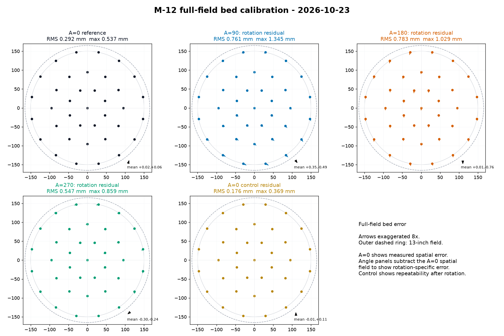

# Lab Note: 2026-10-23 - M-12 full-field bed calibration

## Objective

Measure the repeatable bed-XY error left after P100 registration, separate
A=0 position dependence from fixed-position rotation response, and determine
whether the spatial field can be modelled well enough to justify an optional
host-side compensation profile.

## Configuration

- Hardware revisions: RP23CNC `RP23U5XBB` V1.01; existing installed X/Y/A
  mechanics and production toolhead.
- Wiring/pin map: unchanged.
- Firmware commit/build: installed production controller build; no firmware
  changed for this measurement.
- grblHAL settings: not captured in the supplied message; not changed as part
  of this analysis.
- P100 correction: left unchanged. The current macro was not modified.
- Converter settings/sample: `samples\gcode\bed-error-map.gcode`, five passes
  at A=0/90/180/270 with a final A=0 control; one 0.20 mm pen throughout.
- Registration: the exact startup command was not included in the supplied
  message. The sheet layout is the generated calibration; a fresh
  `G65 P113` remains an operational precondition for the verification run.
- Bed mesh: `samples\gcode\bed-mesh-2026-10-11.csv`, copied from the existing
  `bed_mesh_big.csv`. SHA-256:
  `e99cd98458e3521676493815102b1576fba3448926dd7b67dc20b42682a0bb16`.
- Photo: `docs/report/lab-notes/assets/2026-10-23-m-12-full-field-bed-calibration.jpg`,
  2427 x 1828 px. SHA-256:
  `f753d80f13922b61a41eaabfd5d181495599e4aa6163350ace7f213ee89fa12f`.
- Instruments: overhead phone photo and software extraction of the printed
  marker vertices. No independent caliper measurement was used.

## Code, commands, and configuration used

```text
G65 P113
(load samples\gcode\bed-error-map.gcode)
(Cycle Start; continue through four drying M0 pauses)
```

```powershell
python tools\measure_bed_error_photo.py C:\Users\jacks\Downloads\cal.jpg `
  --measurement-out samples\gcode\bed-error-map-2026-10-23.csv `
  --diagnostic-out samples\gcode\bed-error-map-2026-10-23-photo.json `
  --overlay-out samples\gcode\bed-error-map-2026-10-23-overlay.png

python tools\analyze_bed_error_calibration.py `
  --measurements samples\gcode\bed-error-map-2026-10-23.csv `
  --bed-mesh samples\gcode\bed-mesh-2026-10-11.csv `
  --profile-out samples\gcode\bed-error-compensation-2026-10-23.json `
  --report-out samples\gcode\bed-error-analysis-2026-10-23.json
```

## Procedure

1. Plot the full-field sheet after registration with the same pen for all five
   passes. Allow each pass to dry at its `M0` pause.
2. Photograph the complete circular sheet from above with all four large
   fiducials visible.
3. Extract the four fiducials, 185 station L markers, and 74 station-label
   glyphs from the photo. Fit the projective sheet transform from the known
   fiducial coordinates.
4. For every station L, fit the horizontal and vertical arm centrelines and
   use their intersection as the measured corner. Map that point back through
   the projective transform to bed XY.
5. Compare the A=0 reference, A=0 control, and fixed-position 90/180/270
   replays. Correlate the normalized fields with the existing bed mesh.

## Results

### Photo extraction validation

- Connected components: 4 large fiducial components, 185 station L
  components, and 74 label glyphs. This matches the generated sheet exactly.
- All 189 measurement rows were populated; none were blank.
- Nearest expected-marker assignment distance: minimum `0.021 px`, median
  `2.574 px`, maximum `6.863 px`. That maximum is the measured residual
  displacement before assignment, not an identification ambiguity; it is less
  than one-sixth of the `10 mm` cross-marker lane separation.
- The automated expected/detected overlay is retained as
  `assets/2026-10-23-m-12-full-field-bed-calibration-overlay.jpg`.
- Marker-threshold sensitivity was checked at thresholds 18, 20, and 22. All
  three found the same `4/185/74` component counts; A=0 spatial RMS stayed
  `0.290..0.292 mm`, leave-one-out RMS stayed `0.194..0.197 mm`, and the
  maximum fitted correction stayed `1.271..1.331 mm`.

### Field statistics



| Field | RMS mm | p95 mm | Maximum mm |
|---|---:|---:|---:|
| Raw station error | 0.581 | 1.073 | 1.309 |
| A=0 spatial reference | 0.292 | 0.519 | 0.537 |
| A=0 control after rotations | 0.176 | 0.324 | 0.369 |
| 90-degree residual | 0.752 | 1.298 | 1.340 |
| 180-degree residual | 0.784 | 0.979 | 0.986 |
| 270-degree residual | 0.557 | 0.851 | 0.862 |

- A=0 spatial error is small but repeatable. The A=0 control is tighter,
  showing that the measured spatial field repeats after the complete rotation
  sequence.
- The 90/180/270 means are not purely spatial:
  - 90 degrees: mean `(+0.354, -0.481)` mm.
  - 180 degrees: mean `(+0.018, -0.764)` mm.
  - 270 degrees: mean `(-0.300, -0.268)` mm.
- The 180-degree direction is the one most directly relevant to opposite
  quadrants: the replay lands about `0.76 mm` south of its expected position
  before the profile correction.

### Profile validation

- Leave-one-station-out RMS: `0.197 mm`.
- Leave-one-station-out maximum: `0.552 mm`.
- Improvement over the raw station error: `66.1 %`.
- The software acceptance gates pass (`0.35 mm` RMS, `0.90 mm` maximum,
  at least `10 %` improvement).
- Generated profile:
  `samples\gcode\bed-error-compensation-2026-10-23.json`, fingerprint
  `911d2694c8c9`, coverage radius `165.1 mm`, maximum correction
  `1.331 mm`.
- The compensated verification G-code has a maximum commanded radius of
  `163.940 mm`, still inside the `165.1 mm` planned field and `177.8 mm`
  sheet radius.

### Bed-mesh correlation

- A=0 X error versus gap: `r = -0.187`.
- A=0 Y error versus gap: `r = -0.548`.
- A=0 error magnitude versus gap: `r = -0.325`.
- Angle residual magnitude versus gap:
  - 90 degrees: `r = -0.574`.
  - 180 degrees: `r = +0.341`.
  - 270 degrees: `r = +0.744`.

The height correlation is mixed. A=0 Y and the 270-degree residual show a
moderate-to-strong relationship, while 90 and 270 have opposite signs. That is
consistent with a rotating height/plane or carriage coupling term, not a
single static translation. The mesh includes the paper and therefore cannot
separate paper deformation from bed-surface error by itself.

## Difficulties and corrective actions

- The first component extraction pass used the entire photo instead of a
  working circle and included surrounding machine features. The extractor was
  restricted to the known round field; the corrected run reproduced the exact
  4/185/74 component counts.
- The fiducial shape is a two-segment marker whose bend is not the nominal
  coordinate. Its outer endpoint is used for the projective fit. The station L
  uses the shared corner. The final overlay confirms every detected station
  corner lies on the printed arm intersection.
- A single overhead photo was available. The A=0 control provides an internal
  repeatability check, but a second photo or second printed verification
  remains useful for independent optical uncertainty.

## Interpretation

The result supports an optional host-side compensation profile, but it does
not justify changing P100 again. The profile is modelling a repeatable
position/angle-dependent field of roughly `0.2 mm` RMS after fitting. The
remaining angle means and the mixed bed-mesh correlations show that vertical
height/plane/runout or rotating carriage coupling is still physically present.
The map can cancel the measured lateral effect; it cannot repair the bed.

## Decisions and next action

- Keep P100 center and A-index constants unchanged.
- Treat `bed-error-compensation-2026-10-23.json` as the first fitted profile,
  not yet a production-qualified machine calibration.
- The compensated verification program is
  `samples\gcode\bed-error-verify.gcode`, generated from that profile.
- Next: after a fresh `G65 P113`, print the verification sheet on a fresh
  14-inch round sheet, photograph it, and require the replay residuals to
  decrease without introducing a new spatial field. If they do not, inspect
  bed plane/runout and carriage coupling rather than accepting the software
  profile.
