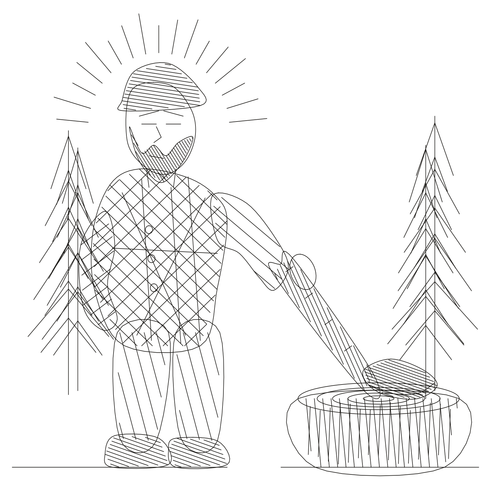

# Ironwood for Turtletoy

Paste the complete contents of [`ironwood.js`](ironwood.js) into a new
[Turtletoy](https://turtletoy.net/turtle/new) code box.

**Ironwood** is a woodcut-inspired scene: a bearded lumberjack rests one hand on
a long felling axe planted in an end-grain chopping block. Dense crosshatching
describes the flannel and steel, while procedural pine ranks and a geometric
sunrise frame the figure.

## Adjustable controls

- `beardDensity`: beard and axe-head hatching density
- `shirtDensity`: crosshatch spacing through the flannel
- `woodDensity`: grain hatching across the chopping block
- `backgroundTrees`: number of pines
- `seed`: deterministic variation used by the scene generator

The default sketch produces 1,734 line points within Turtletoy's native
`-100..100` canvas.

## Plot notes

- Export SVG from Turtletoy after `walk()` finishes.
- The composition stays inside Turtletoy's native canvas bounds.
- Use a fine pen first; the preview uses the equivalent of a `0.22 mm` line.
- XY-only motion is recommended for the first physical print.
- Import the exported SVG with fill disabled.
